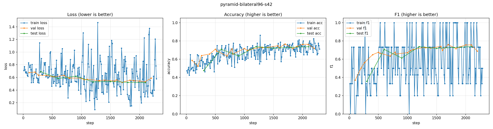

# Pyramid 3D CNN cho phân loại glaucoma (OCT)

Thí nghiệm kiến trúc **pyramid/FPN 3D** cho bài toán glaucoma trên Harvard-GF, chạy trong
cùng pipeline với `Simple3DCNN` và các backbone 3D khác. Mã nguồn:
`models/glaucoma/model.py` (`Pyramid3DCNN`, `architecture: pyramid3dcnn`).

## 1. Động lực

`Simple3DCNN` hiện tại lấy đặc trưng bằng global average pooling sau 4 khối conv. Cách đó giữ
được tín hiệu toàn cục nhưng **mất bố cục không gian**: độ dày RNFL thay đổi cục bộ, còn hình
dạng globe/đĩa thị chỉ hiện ở thang thô. Pyramid 3D giải quyết cả hai:

| Thang | Thông tin giữ lại |
|---|---|
| Level 0-1 (H/W lớn) | chi tiết lớp võng mạc, ranh giới RNFL mỏng |
| Level 2-3 (H/W nhỏ, depth đầy đủ) | hình dạng toàn cục, phân bố lớp theo trục depth |

Top-down fusion đưa ngữ nghĩa thô xuống level mịn (FPN); head lấy **mọi** level nên classifier
thấy đồng thời chi tiết và ngữ cảnh.

## 2. Kiến trúc (`Pyramid3DCNN`)

Giữ nguyên 3 fix bắt buộc của repo:

1. **GroupNorm** (`norm: group`, `norm_groups: 8`) — ổn định với batch 2-4.
2. **Pooling dị hướng `(2,2,1)`** — H/W giảm, depth giữ nguyên 200, RNFL không bị nghiền.
3. **Raw logits + CrossEntropyLoss**, `dropout` trước classifier.

Thêm phần pyramid:

- Stem `Conv3d(1→16, 3³) + GroupNorm + ReLU` tại độ phân giải gốc.
- 4 level, channels `(16, 32, 64, 128)`; mỗi level: conv 3³ + GN + ReLU + residual 3³, rồi pool.
- **Lateral 1×1** cho `fuse_levels` level thô nhất (mặc định 3) → `fusion_dim` (64).
- **Top-down**: upsample trilinear level sâu hơn về đúng H/W của level trên, cộng lateral,
  smooth bằng conv 3³ + GN + ReLU.
- **Head đa thang**: global average pool từng level (level không fuse giữ kênh gốc, level fuse
  dùng `fusion_dim`), concat → `Linear(→64) → ReLU → Dropout(0.3) → Linear(→2)`.

Shape với input `1×200×200×200`, `fuse_levels=3`:

| Level | Feature map (C × D × H × W) | Vai trò |
|---|---|---|
| stem | 16 × 200 × 200 × 200 | conv đầu, chưa pool |
| L0 | 16 × 200 × 100 × 100 | raw → head |
| L1 | 32 × 200 × 50 × 50 | lateral → 64 |
| L2 | 64 × 200 × 25 × 25 | lateral → 64 |
| L3 | 128 × 200 × 12 × 12 | lateral → 64, đỉnh top-down |
| head | `16 + 3×64 = 208` | concat sau GAP |

Tham số: **1,129,298** (pyramid, mặc định) vs **881,122** (`simple3dcnn`, cùng hidden) —
+28%, chủ yếu ở lateral/smooth và head rộng hơn.

## 2b. Biến thể `PyramidResNeXt3D` (ResNeXt + FPN)

`PyramidResNeXt3D` giữ nguyên **block/stage của encoder thắng sweep** (`single3d-resxt3d`:
grouped bottleneck, `features=(32,64,128,192)`, `groups=8`, `base_width=8`, GroupNorm,
stride `(2,2,1)` rồi `(2,2,2)×3`) nhưng mở 4 level và gắn pyramid:

- stem conv 3³ → 32 kênh tại độ phân giải gốc;
- mỗi level: 1 block giảm mẫu + 1 block giữ mẫu (đúng chuỗi của `Enc3DResNeXt`);
- lateral 1×1 → `fusion_dim` (mặc định 128) cho `fuse_levels` level cuối, top-down
  trilinear + add + smooth 3³;
- head GAP đa thang: level không fuse giữ kênh gốc, level fuse dùng `fusion_dim`;
- `fuse_levels=0` = ResNeXt + multi-scale head (ablation).

Tham số: **1,608M** (mặc định) vs 1,129M của `Pyramid3DCNN`. Vì block grouped và các level
sau nhỏ, compute thấp hơn pyramid CNN thuần ở cùng 96³.

Chạy: kernel `trnquanghuyn/glaucoma-pyramid-resnext-bilateral96`, 15 epoch, batch 4 × accum 2,
lr 1e-4, seed 42; so trực tiếp với `single3d-resxt3d` (77,11% test) và run pyramid 96³ (74,00%).

## 2c. Head giữ đặc trưng mảnh (`head_pool`)

GAP toàn cục làm loãng dải RNFL mỏng với phần còn lại của A-scan. Hai chế độ thay thế
(config `model.head_pool`, áp dụng cho cả `Pyramid3DCNN` và `PyramidResNeXt3D`):

- `gap` (mặc định): `AdaptiveAvgPool3d(1)` như cũ.
- `depth_attention`: một conv 1×1 chấm điểm từng slice depth (trục cuối), softmax theo depth
  rồi pool có trọng số, sau đó trung bình H/W. Model tự chọn dải mỏng thay vì chia đều.
- `grid`: `AdaptiveAvgPool3d(head_grid)` (mặc định 2×2×2) → giữ **vị trí** tổn thương thay vì
  xoá bố cục; head rộng ×`head_grid³`.

Chạy thử head mảnh trên cùng 96³: `model.head_pool=depth_attention` (kernel
`trnquanghuyn/glaucoma-pyramid-thinhead-bilateral96`, 12 epoch) — so với run GAP 96³ (74,00%)
và baseline matched (72,00%).

## 3. Cấu hình

`configs/glaucoma.yaml` là config glaucoma duy nhất (raw 200³). Hai khóa mới có mặt với giá trị
mặc định, không ảnh hưởng `simple3dcnn`:

```yaml
model:
  fusion_dim: 64
  fuse_levels: 3   # 0 = tắt top-down, chỉ còn multi-scale head
```

Chạy pyramid bằng override (không tạo config resolution khác):

```bash
python -m pipeline.train --cfg configs/glaucoma.yaml \
  --set model.architecture=pyramid3dcnn model.fusion_dim=64 model.fuse_levels=3 \
        run_name=pyramid-bilateral96-s42
```

Thực nghiệm chính chạy trên **Kaggle GPU**: `notebooks/3d_glaucoma_pyramid_kaggle.ipynb`
(Bilateral-96 từ HF, batch 4 × grad-accum 2, 15 epoch, AMP fp16, log W&B + artifact).
Notebook chỉ dùng GPU; không chạy train trên máy local.

**Vì sao 96³ (tạm thời) và đính chính 200³:** lần đo đầu trên T4 cho 33 s/optimizer-step với
raw 200³ — nhưng đó là **bf16 emulation** (torch≥2.4 trả `is_bf16_supported()=True` trên T4/P100
rồi chạy bf16 bằng phần mềm, chậm ~10×). Sau khi sửa `resolve_amp_dtype` sang **fp16 native**,
ResNeXt+FPN 200³ chạy **0,78 s/sample** (bs1, ~27 phút/epoch, 8 epoch ≈ 3,6h) trên Modal T4.
Vì vậy 200³ là cấu hình chính từ đây; các run 96³ ở trên chỉ còn là tham chiếu lịch sử (và timing
của chúng cũng bị ảnh hưởng bởi emulation).

Đo chi phí step/VRAM trên GPU:

```bash
python scripts/bench_pyramid.py --res 96 --batch-sizes 1,2,4 --steps 3
```

## 4. Kiểm chứng đã chạy

- `ruff check` + `ruff format --check` trên các file thay đổi: sạch.
- `pytest tests/test_pyramid.py -q`: forward/backward, gradient hữu hạn, `fuse_levels` 0/2/3/9,
  head nhận đủ level, GroupNorm bất biến theo batch size, validate config (kể cả giá trị sai).
- End-to-end qua `pipeline.train --smoke` trên dữ liệu tổng hợp 32³ (32 train / 8 val / 8 test,
  tín hiệu phân biệt được): chạy hết train → eval → test → lưu checkpoint/curves, val/test acc 1.0.
  Đây chỉ là kiểm tra wiring, không phải kết quả khoa học.
- Toàn bộ `pytest tests` trên Windows có 38 test fail sẵn ở các module `test_final_*`
  (`OSError: could not get source code`, lỗi môi trường), không liên quan thay đổi này.

## 5. Kết quả run 96³ (seed 42)

Run: W&B `glaucoma-thesis/pyramid-bilateral96-s42` (kernel private
`trnquanghuyn/glaucoma-pyramid-bilateral96`). Bilateral-96, batch 4 × grad-accum 2, lr 1e-4,
tối đa 15 epoch, early stop patience 6. GPU T4, ~3,9 s/step, dừng ở step 2300 (≈8,7 epoch).

- **Val tốt nhất:** step 1700 (≈6,5 epoch), loss **0,5222**, acc **76,67%**, F1 **76,05%**.
- **Test (best model, 900 mẫu):**

| Metric | Giá trị |
|---|---:|
| Loss | 0,5160 |
| Accuracy | **74,00%** |
| Balanced accuracy | **74,37%** |
| MCC | **0,486** |
| F1 (macro) | **73,99%** |
| F1 (glaucoma +) | 74,57% |
| Precision / Recall (glaucoma +) | 79,58% / 70,14% |

Confusion (suy ra từ precision/recall + 489 dương / 411 âm): TP 343, FP 88, FN 146, TN 323.



**So sánh tham chiếu** (cùng nhóm 96³ trong `3d-backbone-sweep.md`, không cùng recipe):

| Model | Test acc | Balanced acc | Test F1 | MCC |
|---|---:|---:|---:|---:|
| `Pyramid3DCNN` (run này) | **74,00%** | 74,37% | 73,99% | 0,486 |
| `PyramidResNeXt3D` (run này) | **74,67%** | **75,54%** | **74,63%** | **0,515** |
| `Pyramid3DCNN` aniso 96×96×200 (depth 200) | 73,11% | 73,55% | 73,11% | 0,470 |
| `Pyramid3DCNN` + depth-attention head (Modal) | 74,67% | 75,39% | 74,66% | 0,510 |
| `Simple3DCNN` (matched, cùng recipe) | 72,00% | 72,58% | 72,00% | 0,452 |
| `single3d-cnn3d` (tham chiếu sweep) | 74,44% | — | 77,41% | 0,483 |
| `single3d-resxt3d` (tham chiếu sweep) | **77,11%** | 77,19% | **78,36%** | **0,542** |

Baseline matched: kernel `trnquanghuyn/glaucoma-simple3dcnn-bilateral96` (cùng 96³, bs 4 × accum 2,
15 epoch, early stop step 2390; test 72,00%; TP 322, FP 85, FN 167, TN 326).

**Đọc kết quả:** với **cùng recipe**, pyramid hơn `Simple3DCNN` **+2,0 điểm acc, +1,8 điểm balanced
acc, +0,034 MCC**; `PyramidResNeXt3D` (grouped bottleneck + FPN) thêm **+0,67 acc, +1,17 balanced,
+0,029 MCC** so với pyramid CNN. Hướng nhất quán nhưng 1 seed, test 900 mẫu (SE của hiệu ≈ 2,1
điểm) nên chưa đủ khẳng định; `single3d-resxt3d` vẫn hơn run ResNeXt+FPN 2,4 điểm acc (khác recipe
sweep). Với 1 seed, **top-down fusion chưa chứng minh được lợi ích riêng** — ablation
`fuse_levels=0` bị hoãn để dành quota cho resolution/ResNeXt.

**Aniso 96×96×200 (giữ depth 200):** test acc 73,11%, balanced 73,55%, MCC 0,470 — **không hơn**
96³ (74,00 / 74,37 / 0,486; chênh trong 1 SE). 10 epoch, best val step 2600 (loss 0,5232); test
vẫn tăng chậm (71,2% → 73,2% → 73,1%) nhưng xu hướng không cho thấy mất mẫu trục depth là nút thắt.
⇒ Hướng "đặc trưng mảnh" nên dồn vào **head/auxiliary RNFLT**, không phải lưu trữ depth.

**Depth-attention head (Modal, 12 epoch):** test acc 74,67%, balanced 75,39%, MCC 0,510 — ngang
`PyramidResNeXt3D` (74,67 / 75,54 / 0,515) và hơn GAP 96³ +0,67 acc. Attention theo depth không tạo
lợi ích riêng; cả hai trần ~74,7% cho thấy **thay đổi head/kiến trúc đã bão hoà** trên 96³.
Bước tiếp theo hợp lý là **auxiliary RNFLT** (dataset có RNFLT map) hoặc multi-seed để tách nhiễu.

Test đạt 70,9% ở step 600, 73,8% ở step 1200 rồi dao động 72–74% đến step 2300 ⇒ **plateau từ
~4,5 epoch**; kéo dài schedule không phải đòn bẩy chính. Lưu ý val chỉ 300 mẫu (SE ≈ 2,6 điểm),
nên "best val" ở step 1700 là chọn theo nhiễu; test 900 mẫu có CI95 ≈ ±2,9 điểm — chênh lệch
2,0–2,7 điểm so với baseline matched vẫn nằm trong ~1,3 SE của hiệu.

## 5b. Kết quả raw 200³ (vast.ai RTX 3090) và so sánh từng ca

Recipe như mục 5 nhưng batch 1 × accum 8, không bilateral. Số dưới đây tính lại từ xác suất từng
mẫu trên 900 ảnh test (`hf://tqhuyen/glaucoma-raw200-runs/post/report-assets/glaucoma/`).

| Model | Dữ liệu | Epoch | Acc | AUC | MCC |
|---|---|---:|---:|---:|---:|
| Simple3DCNN | raw 200³ | 8 | 67,11% | 0,720 | 0,333 |
| Pyramid3DCNN | raw 200³ | 8 | 72,44% | 0,787 | 0,450 |
| **Pyramid3DCNN** | raw 200³ | 15 (dừng sớm 12,6) | **74,44%** | 0,815 | 0,484 |
| PyramidResNeXt3D | raw 200³ | 8, seed 42 / 43 | 64,44% / 64,89% | 0,710 / 0,706 | 0,277 / 0,298 |
| PyramidResNeXt3D | bilateral 96³ | 15 | 74,78% | **0,827** | **0,517** |

- Trên raw 200³ chỉ Pyramid3DCNN theo kịp các model bilateral 96³; Simple và ResNeXt raw tạo
  thành một cụm hành vi riêng, kém hơn (tương quan xác suất với cụm tốt 0,59–0,71).
- Các model tốt (Pyramid raw, cả 3 model bil96) hội tụ về gần cùng một hàm quyết định
  (r = 0,90–0,97) dù khác dữ liệu đầu vào, nên ensemble gần như không tăng.
- Chưa model nào vượt SOTA `single3d-resxt3d` (77,11%, AUC 0,854); recipe vẫn khác (lr, batch,
  tiêu chí chọn checkpoint).

Báo cáo đầy đủ có hình ca bệnh và saliency: `hf://tqhuyen/glaucoma-raw200-runs/reports/glaucoma_report.html`
(dựng lại bằng `python scripts/build_report.py`).

## 6. Kế hoạch đọc kết quả

1. So với `simple3dcnn` **cùng 96³, cùng batch/lr/epoch, seed 42** (đã đẩy kernel
   `trnquanghuyn/glaucoma-simple3dcnn-bilateral96`; chờ slot GPU).
2. Ablation tách đóng góp:
   - `fuse_levels=0`: chỉ multi-scale head (không top-down) → đo giá trị của FPN.
   - `fuse_levels=2`: bỏ lateral 24×24 (giảm VRAM) → kiểm tra level mịn có cần fuse không.
   - `fusion_dim=32`: kiểm tra head rộng có phải nguồn lợi ích.
3. **Anisotropic 96×96×200** (đang chờ slot): giữ nguyên depth 200, chỉ downsample H/W về 96
   từ raw 200³ trên Kaggle, rồi train cùng recipe (10 epoch, batch 4 × accum 2, seed 42).
   Storage ~6,1 GB thay vì 26,4 GB, nhưng lúc build vẫn phải tải raw 200³ (đỉnh scratch ~21 GB).
   Đây là phép so sánh sạch với run 96³: cùng H/W, chỉ khác mẫu trục depth — tách đúng giả thuyết
   "mất chi tiết lớp mỏng khi resize". So test tại cùng epoch (96³: 73,8% ở epoch 10) và dùng
   CI95 ±2,9 điểm để kết luận.
4. Báo cáo **balanced accuracy, MCC, AUC, F1** cùng accuracy; test lệch lớp 411/489 nên
   accuracy đơn lẻ dễ gây kết luận sai. Loại model nếu dự đoán lệch một lớp (balanced acc ≈ 0.5).
5. Ghi `sec/epoch` và peak VRAM từ W&B cạnh baseline để so chi phí.

## 7. Rủi ro

- **Chi phí 200³**: đo 33 s/step (T4) ⇒ không khả thi trong 12 h; nếu cần 200³ thật phải giảm
  `fuse_levels`/`fusion_dim` hoặc chấp nhận 2-3 epoch. 96³ là cấu hình thực nghiệm chính.
- **Overfit**: 2100 mẫu train, model 1.1M tham số; early stop patience 6, dropout 0.3, wd 0.01.
- **Không so sánh trực tiếp** với các run 200³ khử nhiễu trong `3d-backbone-sweep.md` khi khác
  resolution/tiền xử lý; chỉ dùng làm tham chiếu.

## 8. Fallback Modal (khi hết quota Kaggle)

`scripts/modal_train.py` chạy cùng pipeline trên Modal (GPU T4), dùng Volume
`glaucoma-thesis-vol` cho data/output và secret `glaucoma-secrets` (HF_TOKEN, WANDB_API_KEY):

```bash
python -m modal secret create glaucoma-secrets --from-dotenv .env --force
python -m modal run scripts/modal_train.py --experiment smoke        # kiểm tra image/secret/GPU
python -m modal run scripts/modal_train.py --experiment resnext      # ResNeXt + FPN, bilateral-96
python -m modal run scripts/modal_train.py --experiment thinhead     # depth-attention head
python -m modal run scripts/modal_train.py --experiment aniso96x200  # build + train 96x96x200
```

Mỗi hàm `train` log W&B như Kaggle và ghi `best_model.pt`/`metrics.jsonl`/`test_results.json`
vào `/vol/outputs/<run>`; data được cache lại giữa các lần chạy.
